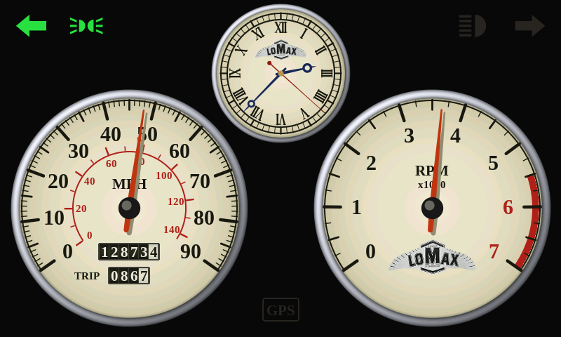
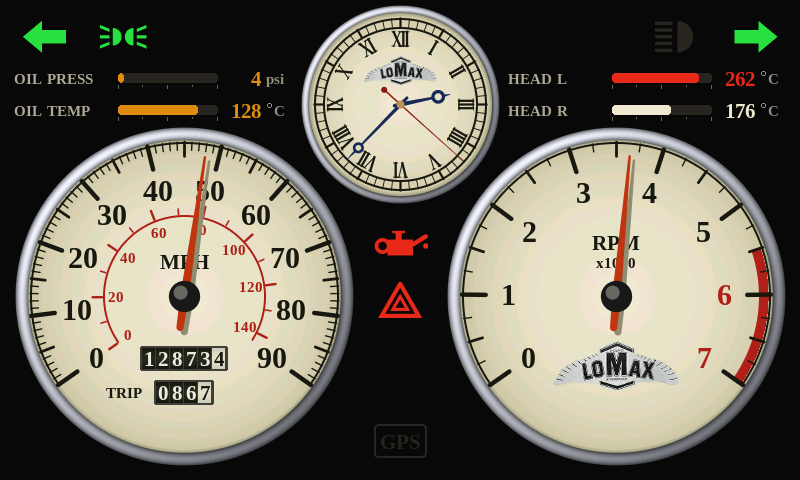

# Lomax engine and lights box

A small box behind the dash that reads the engine's sensors, switches the
lights from the car's own switches, and sends everything to the 7" dash over
ESP-NOW (no router, no pairing app). Its firmware is `src/enginebox.cpp`:
```
pio run -e enginebox -t upload
```



| Warnings (hazards on, no oil pressure, a hot head) | No box heard |
|---|---|
|  |  |

## What it does
- **Oil pressure** from a 5 V transducer (0-100 psi), and the engine's own
  **oil pressure switch**, which lights the red oil lamp on the dash as the
  original warning light does. The lamp also lights if the gauge reads under
  `OIL_PSI_LOW` with the engine running.
- **Oil temperature** from a 2-wire NTC sender.
- **Head temperature** of each cylinder from a K-type thermocouple under the
  spark plug.
- **Revs** from the coil, the same optocoupler circuit as the dash's, which
  frees the dash's IO6.
- **Road speed** from an optional wheel sensor, as a fallback for the GPS or
  instead of it (`SPEED_SOURCE` in `lomax_config.h`).
- **Lights**: sidelights, daytime running lights, left and right indicators
  with hazards (90 flashes a minute), brake lights (see below), and three
  spare outputs.
- **Spare inputs**: eight on a PCF8574, one spare analogue input, and the
  supply voltage, all sent to the dash for later use.

The lights never depend on the dash. With the screen unplugged they work
just the same; the dash only shows what the box reports.

### Brake lights
Out of the box (`BRAKE_VIA_BOX 0`) the brake switch stays wired straight to
the brake lamps, as the car has it. The box only reads the switch, and DO5
is a spare. Set `BRAKE_VIA_BOX 1` to switch them from DO5, but then a dead
box or a blown box fuse means no brake lights.

### Daytime running lights
On with the ignition once the engine runs, off while the sidelights are on.
`DRL_NEEDS_ENGINE 0` lights them with the ignition alone, and
`DRL_OFF_WHEN_INDICATING 1` puts them out while the indicators flash
(the law asks for this if a DRL sits within 40 mm of an indicator).

### Asleep
The box is on a **permanent** feed, so the hazards and sidelights work with
the key out. With the ignition, hazards and sidelights off for 30 s it goes
into deep sleep, and any of those coming on wakes it in about a third of a
second.

## Parts
| Part | Notes |
|---|---|
| ESP32-S3-DevKitC-1 (N8 or N8R2) | The brain |
| ADS1115 module | 16-bit ADC: oil pressure, oil temp, spare, supply voltage |
| 2 x MAX31856 module | Thermocouple readers (they cope with grounded thermocouples) |
| 2 x K-type spark plug washer thermocouple, 14 mm | With K-type extension wire |
| Oil pressure transducer, 0-100 psi, 5 V, 0.5-4.5 V out | On a T-piece at the oil pressure switch |
| 2-wire NTC oil temperature sender | Sump plug adaptor or dipstick type; put its table in `NTC_TABLE` |
| 8-channel PC817 optocoupler module (12 V inputs) | The switch inputs |
| PCF8574 module + 8 more optocouplers | Only if you want the spare inputs |
| ULN2803 (or an 8-channel MOSFET module) | Drives the relay coils |
| 6 x 12 V automotive relays (30 A) with bases and fuses | Sidelights, DRL, indicators x2, spares as needed |
| PC817, 1N4007, 2 x 4.7 kΩ ½ W, 10 kΩ, 1 nF | The coil input, as the dash's |
| Buck converter 36 V in, 5 V 1 A out; 1 A fuse; TVS diode (SMBJ24A); P-MOSFET or diode for reverse polarity | Power |
| Sealed box, Deutsch DT (or similar) connectors | |

## Pins (ESP32-S3-DevKitC-1)
| Pin | Job |
|---|---|
| IO8, IO9 | I2C: ADS1115 (0x48), PCF8574 (0x20) |
| IO12, IO11, IO13 | SPI SCK, MOSI, MISO: both MAX31856 |
| IO10, IO14 | MAX31856 CS: left head, right head |
| IO15 | Coil (optocoupler) |
| IO16 | Wheel sensor (optocoupler) |
| IO4, IO5 | DI1, DI2: indicator stalk left, right |
| IO6 | DI3: hazard switch |
| IO7 | DI4: brake switch |
| IO1 | DI5: sidelight switch |
| IO2 | DI6: main beam (only read, for the dash's lamp) |
| IO17 | DI7: oil pressure switch |
| IO18 | DI8: ignition |
| IO21, IO39 | DO1 sidelights, DO2 daytime running lights |
| IO40, IO41 | DO3 left indicators, DO4 right indicators |
| IO42 | DO5 brake lights (a spare unless `BRAKE_VIA_BOX 1`) |
| IO47, IO3, IO46 | DO6, DO7, DO8 spares |

ADS1115 inputs: A0 oil pressure, A1 oil temperature, A2 spare, A3 supply.

## Wiring

### Power
```
+12 V permanent ──[1 A fuse]──►|── TVS to chassis ── buck IN+    buck 5 V ── DevKit 5V, transducer +5 V
                   (or a P-MOSFET for reverse polarity)            buck GND ── DevKit GND
chassis (one point on the engine block) ──────────────── buck IN−
```
Ground the box, the sensors and the thermocouple boards to the same point on
the block, so the readings don't move with the starter or charging current.

### Switch inputs
Each switch input goes through one channel of the optocoupler module, as the
dash's lamp inputs do: the wire that's at +12 V when the switch is on goes to
the channel's input, and the output pulls the pin low. Tap:
- the indicator stalk's left and right wires (they no longer go to the lamps,
  and the flasher unit comes out: the box does the flashing)
- the hazard switch's output
- the brake switch's output (it still feeds the brake lamps directly)
- the sidelight switch's output (it now only tells the box)
- the main beam feed
- the ignition feed

**Oil pressure switch.** It closes to ground when the pressure is low. Wire the
optocoupler input from ignition +12 V to the switch's terminal, alongside the
existing warning lamp, which can stay:
```
ignition +12 V ──[2.2 kΩ]── PC817 anode   PC817 cathode ── oil pressure switch terminal
```
This channel's input minus goes to the switch, not to ground, so use a loose
PC817 for it if your module's inputs share a common ground.

### Outputs
DO1-DO8 go to a ULN2803's inputs. Each ULN2803 output sinks one relay
coil's negative; the coils' positive goes to the fused +12 V. The ULN2803's
COM pin goes to +12 V too (its built-in flyback diodes). Each relay switches
its lamps from its own fuse. Asleep or restarting, the ULN2803's own
pull-downs hold every relay off.

The indicator relays switch at 90 a minute, which ordinary 30 A relays take
for years. LED lamps flash at the right rate here (no flasher unit to fool).

### Oil pressure transducer
```
transducer +5 V ── buck 5 V     transducer GND ── box GND
transducer OUT ──[10 kΩ]──┬── ADS1115 A0
                          └─[20 kΩ]── GND
```
The divider keeps the ADS1115 under 3.3 V (4.5 V becomes 3.0 V).

### Oil temperature sender
```
3.3 V ──[1 kΩ]──┬── ADS1115 A1
                └── sender terminal (its body grounds through the engine)
```

### Thermocouples
Each washer thermocouple's two wires go to its MAX31856's T+ and T− (yellow
is +, red is − on UK colours; swap them if the reading falls as the engine
warms). Use K-type extension wire all the way, kept away from the HT leads.

### Supply voltage and spare analogue input
```
+12 V ──[47 kΩ]──┬── ADS1115 A3        spare 0-3.3 V signal ── ADS1115 A2
                 └─[10 kΩ]── GND
```

### Coil and wheel sensor
The coil goes in exactly as on the dash (see LOMAX.md, "Rev counter from the
coil"), to IO15. Remove the dash's own coil wire once the box has it. A 3-wire
hall sensor (12 V, NPN) for road speed goes through an optocoupler channel to
IO16; set `WHEEL_FITTED 1` and `WHEEL_PULSES_PER_MILE`.

## Pairing
The box broadcasts; the dash takes the first box it hears and remembers it,
so another car's box never moves your needles. Type `unpair` on the dash's
USB serial port to let it take a different box.

## Trying it out
- On the dash's serial port, `demo` turns on a made-up drive for trying the
  dash without a box: a minute round and round of pulling away through the
  gears, a cruise at 60, the left indicator, a stop and the hazards, with the
  engine gauges following. `demo` again turns it off. A real box always wins,
  and the demo puts no miles on the odometer. A build with `-D ENGINE_DEMO=1`
  starts with it on.
- On the box's serial port, `status` prints every reading and input, and
  `out 6 on` / `out 6 off` switch a spare output (6-8, or 5 while the brake
  lights are wired straight).

## Settings
At the top of `src/enginebox.cpp`: what's fitted, the brake and DRL choices,
the flash rate, and each sensor's calibration. The gauges' scales and
warning levels are in `src/lomax_config.h` ("engine box").
