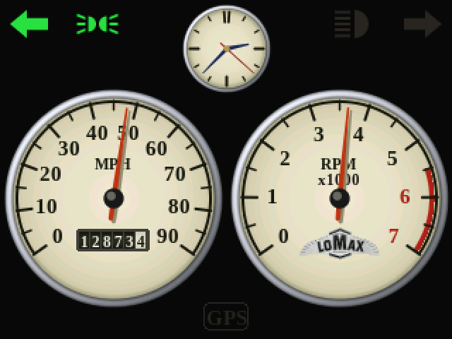
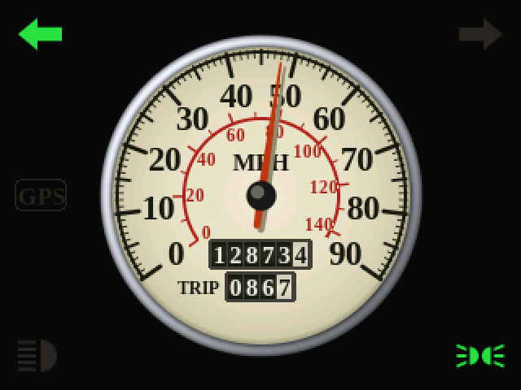
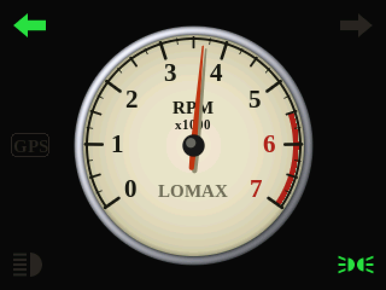
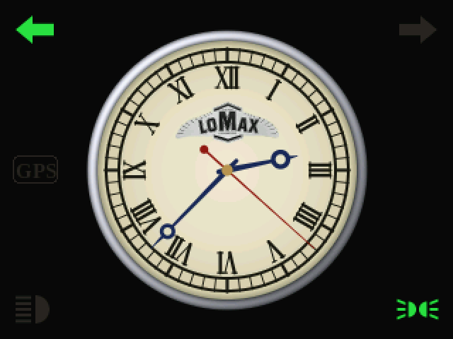
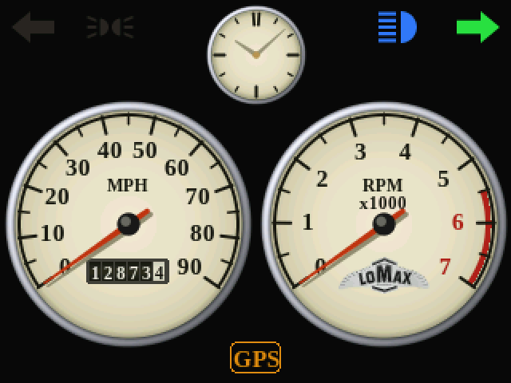
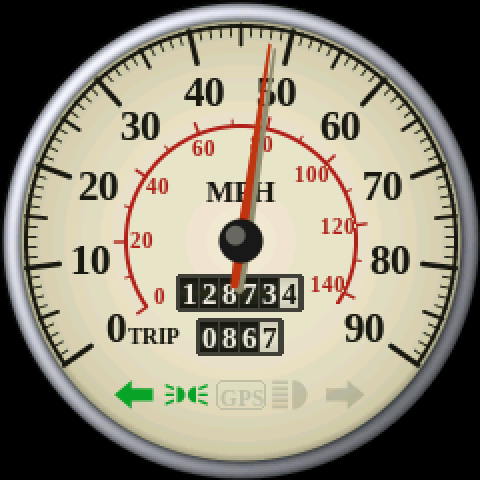
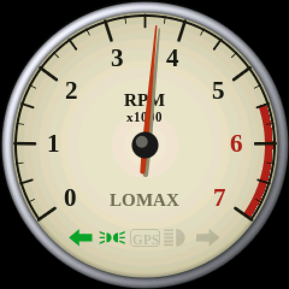
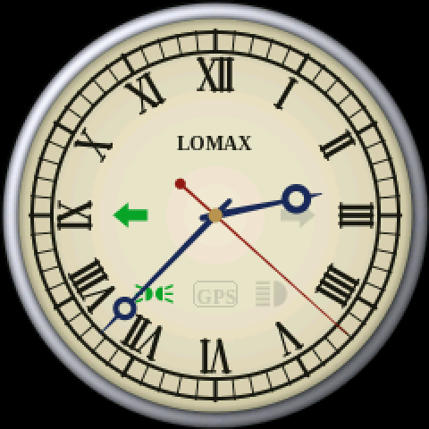
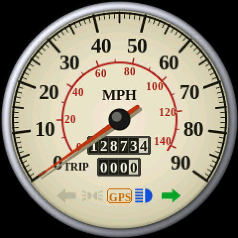

# Lomax dashboard

A dash-mounted speedometer, rev counter and clock for a Lomax on a 2CV
engine and chassis. It's a separate firmware (`src/lomax.cpp`) that runs on
either of two boards:

- the 2.8" **ESP32-2432S028** ("Cheap Yellow Display"), the heater firmware's board:
  `pio run -e lomax -t upload`
- the round 1.28" **Waveshare ESP32-S3-Touch-LCD-1.28-B**, one dial at a time:
  `pio run -e lomax_round -t upload`
  (see [Round screen](#round-screen-waveshare-esp32-s3-touch-lcd-128-b))

### On the CYD

| Side by side | Speedo |
|---|---|
|  |  |
| **Rev counter** | **Clock** |
|  |  |
| **Start-up** | **No GPS fix yet** |
|  |  |

### On the round screen
| Speedo | Rev counter | Clock |
|---|---|---|
|  |  |  |
| **Start-up** | **No GPS fix yet** | |
|  |  | |

## What it shows
- **Speed** from a GPS module, in mph. The big speedo also has an inner km/h scale.
- **Engine speed** from the ignition coil's pulses, 0 to 7000 rpm, red from 5500.
- **Old style clock**: a cream face with Roman numerals and blued Breguet hands. A
  ticking seconds hand runs once the GPS has set the time. It shows UK time and
  changes between GMT and BST by itself. Until the GPS has set it, the clock
  stands at ten past ten with grey hands.
- **Odometer and trip** as drum counters in the speedo, counted from the GPS
  speed. They're saved in the board's flash every tenth of a mile and whenever
  the car stops.
- **Warning lamps** around the dials: left and right indicator arrows (green),
  main beam (blue), sidelights (green), and an amber **GPS** lamp while there's
  no fix (the speedo reads 0 then).
- **Start-up**: the LOMAX badge fades in, then all the lamps light and both
  needles sweep to full scale and back, like a car's own bulb check.
- **Night**: with the sidelights on, the backlight dims (`BRIGHT_NIGHT`).

**Tap** the screen for the next page: side by side → speedo → rev counter →
clock (the round screen has no side-by-side page). It remembers the page.
**Hold 2 s** to zero the trip.

Over USB (115200 baud), `odo 12873.4` sets the odometer to the car's own
reading, and `trip 0` zeroes the trip.

## Parts
- ESP32-2432S028 (CYD) 2.8" board, or the round Waveshare ESP32-S3-Touch-LCD-1.28-B
- GPS module: u-blox NEO-6M (GY-NEO6MV2) or NEO-M8N, with its antenna
- PC817 optocouplers: one for the coil, plus one per lamp (or a 4-channel
  "PC817 optocoupler module" for the lamps)
- CYD only: a micro SD "sniffer" / extender breakout that plugs into its SD
  slot. Three lamp inputs come out through it.
- A 12 V → 5 V buck converter rated for car use (1 A or more) and an inline fuse
- Resistors and diodes as in the diagrams below

## Pins (CYD)
The CYD has only three free pins on its connectors. The SD slot gives three
more, because no SD card is used. Everything is set in `src/lomax_config.h`.

| Signal | Pin | Where on the board |
|---|---|---|
| GPS TX → | IO35 | P3 (input only, which suits it) |
| Tacho (coil) | IO22 | CN1 (also on P3) |
| Left indicator | IO27 | CN1 |
| Right indicator | IO18 | SD slot CLK |
| Main beam | IO19 | SD slot MISO |
| Sidelights | IO23 | SD slot MOSI |
| 5 V in | VIN | P1 (or the USB socket) |
| 3.3 V / GND | | CN1 |

**Only one indicator lamp wired?** A 2CV has a single dash repeater. Set
`IND_R_PIN` to `-1` and both arrows flash together from IO27. IO18 is then
free for the GPS's RX (see "Faster GPS" below).

## Wiring

### Power
Feed it from an ignition-switched, fused supply through the buck converter:
```
+12 V (ignition) ──[1 A fuse]── buck IN+      buck OUT+ (5 V) ── CYD P1 VIN
chassis ─────────────────────── buck IN−      buck OUT− ───────── CYD P1 GND
```
Choose a converter with reverse-polarity and surge protection, or add a TVS
diode across its input. A car's 12 V has spikes that cheap modules don't survive.

### GPS
```
GPS VCC ── 5 V (P1 VIN) or 3.3 V (CN1)   (the GY-NEO6MV2 takes either)
GPS GND ── GND
GPS TX  ── IO35 (P3)
```
The antenna needs a view of the sky. Under a glass-fibre scuttle works; under
metal doesn't. The first fix from cold can take a minute or two.

### Lamps (indicators, main beam, sidelights)
Each lamp goes through an optocoupler, so no 12 V ever reaches the board.
Tap the wire that feeds each lamp: the left and right indicator lamps, the
main beam feed and the sidelight feed.
```
lamp feed (+12 V when lit) ──[2.2 kΩ]──┬── PC817 pin 1 (anode)
                                       │
                             1N4148 ▲  │  (across the LED, stripe to pin 1)
                                       │
chassis ───────────────────────────────┴── PC817 pin 2 (cathode)

PC817 pin 4 (collector) ── IO27 / IO18 / IO19 / IO23
PC817 pin 3 (emitter)   ── CYD GND
```
The firmware turns on each pin's pull-up, so the input reads LOW while the
lamp is lit. A ready-made 4-channel PC817
module does the same job: power its output side from the CYD's 3.3 V.

### Rev counter from the coil
A 2CV's coil fires both plugs together (wasted spark), once every crank
revolution. That makes one pulse per revolution (`TACHO_PULSES_PER_REV 1`).

Take the signal from the coil's **negative (−) terminal**, the one wired to
the points or electronic ignition. It rings to a few hundred volts at every
spark, so it goes through its own optocoupler with series resistors that can
take that:
```
coil − ──►|──[4.7 kΩ ½ W]──[4.7 kΩ ½ W]──┬── PC817 pin 1
       1N4007                            │
                               1N4148 ▲  │  (across the LED, stripe to pin 1)
chassis ─────────────────────────────────┴── PC817 pin 2

3.3 V (CN1) ──[10 kΩ]──┬── IO22 (CN1)
                       ├── PC817 pin 4
               1 nF ═══╡
                       └── CYD GND ── PC817 pin 3
```
**Never connect the coil to the board directly.** The firmware ignores pulses
that arrive impossibly soon after the last one (`TACHO_MAX_RPM`), which
filters out the coil's ringing. With the engine stopped for half a second the
needle drops to 0.

**Why not D+?** The alternator's D+ terminal is a steady voltage once it
charges. It switches the charge lamp off but carries no pulses, so it can't
give engine speed. Some alternators have a **W** terminal (one stator phase)
that does pulse. If yours has one, it can feed the same circuit: set
`TACHO_PULSES_PER_REV` to (number of poles ÷ 2) × the pulley ratio. If you'd rather not
touch the ignition, a Hall sensor and a magnet on the crank pulley also work
(1 pulse per rev, same input).

## Faster GPS (optional)
GPS modules send their speed once a second by default. The needle eases
between readings, but it lags a moment behind the car. A u-blox module can do
5 a second:
- **From the dash**: wire the GPS's RX to a free pin and set `GPS_TX_PIN`. At
  every start-up the dash switches the GPS to RMC sentences only, 5 a second.
  IO18 is free if you only have one indicator lamp.
- **Or once with u-center** on a PC: CFG-RATE 200 ms, turn off every message
  but RMC, then CFG-CFG "save". This only sticks on modules with flash or a
  backup battery (most NEO-M8N boards).

## Your own logo
Without a logo file, the start-up screen shows LOMAX on a red enamel oval
badge. To show your own artwork instead, use a PNG with a transparent or dark
background:
```
python tools/png2rgb565.py assets/lomax_logo.png --max 300 200 --bg 0x0841 --name lomax_logo --out src/lomax_logo.h
pio run -e lomax -t upload
```
When `src/lomax_logo.h` exists, it's used. Delete it to go back to the badge.

## Settings (`src/lomax_config.h`)
| Setting | Default | |
|---|---|---|
| `SPEEDO_MAX` | 90 | mph at full scale |
| `TACHO_MAX`, `TACHO_RED_FROM` | 7, 5.5 | ×1000 rpm |
| `TACHO_PULSES_PER_REV` | 1 | coil on a 2CV |
| `GPS_MIN_MPH` | 1.5 | below this the car counts as stopped (a parked GPS drifts) |
| `LOCAL_TZ` | UK | POSIX time zone string |
| `BRIGHT_DAY`, `BRIGHT_NIGHT` | 255, 70 | backlight; night is with the sidelights on |
| `LAMPS_ACTIVE_LOW` | 1 | 0 if your inputs go high when lit |

## Round screen (Waveshare ESP32-S3-Touch-LCD-1.28-B)
A 1.28" round IPS screen (GC9A01, 240 × 240) with CST816S touch, in a CNC
metal case about 40 mm across, so it suits a 52 mm gauge pod. It shows one
dial at a time, and the lamps sit inside the dial: a row under the needle's
pivot, or around the clock's centre. Unlit lamps are faint shadows on the
face; lit ones show in colour. On the speedo the upper drum counter is the
odometer and the shorter one below it is the trip.

**Pins.** The board brings out six GPIOs on its SH1.0 connector (a cable
comes with it), plus VSYS (5 V in) and GND. That's exactly enough:

| Signal | Default pin |
|---|---|
| GPS TX → | GPIO18 |
| Tacho (coil) | GPIO17 |
| Left indicator | GPIO16 |
| Right indicator | GPIO15 |
| Main beam | GPIO21 |
| Sidelights | GPIO33 |

**Check these against the pin labels in Waveshare's wiki before wiring.** I
couldn't confirm that connector's pin numbers from Waveshare's pages. Any of
the six can do any of these jobs, so change them in `src/lomax_config.h`
(the `BOARD_ROUND` block) to match. The display and touch pins in
`platformio.ini` come from Waveshare's demo code for this board family
(LCD: SCLK 10, MOSI 11, CS 9, DC 8, RST 14, backlight 2; touch I2C: SDA 6,
SCL 7, reset 13).

The input circuits are the same as for the CYD below: optocouplers for the
lamps and the coil, with the pull-up for the coil going to the board's
3.3 V. Power it with 5 V on **VSYS** from the buck converter (or its USB-C
socket). It also has a battery connector, but leave that empty in a car.

If the picture turns out sideways, change `SCREEN_ROTATION`. If it's
garbled, lower `SPI_FREQUENCY` in `platformio.ini` to 40000000.

## Things to know
- **Sunlight.** The CYD's screen is a small TN LCD, and it washes out in
  direct sun. That matters in an open car. A hood over it helps a lot. Some
  CYD versions (two USB sockets, ST7789) have a brighter IPS panel; see the
  README's troubleshooting table for the driver setting. The round board's
  IPS screen holds up better, but a gauge pod's hood still helps.
- **No signal, no speed.** In tunnels and multi-storey car parks the speedo
  drops to 0 and the GPS lamp lights. If this replaces the car's only
  speedometer, check it meets the MOT / IVA rules for your car.
- **Mount it** away from the coil and HT leads, and keep the signal wires short.

## Previewing on a PC
`tools/lomax_preview` draws the screens with the firmware's own drawing code,
so you can try out colours and layouts without the board (Linux or macOS,
needs g++ and Python with Pillow):
```
pio run -e lomax                 # once, to download TFT_eSPI
sh tools/lomax_preview/build.sh  # pictures in tools/lomax_preview/out (round_*: the round screen)
```
The fonts are Liberation Serif Bold (SIL Open Font License), made by
`python tools/lomax_fonts.py`.
